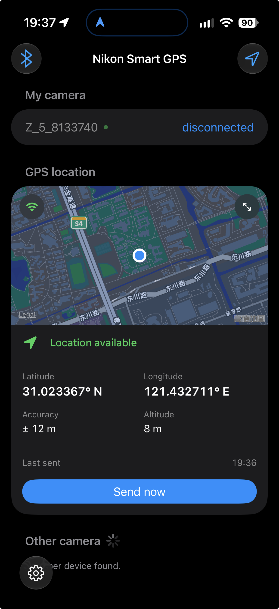
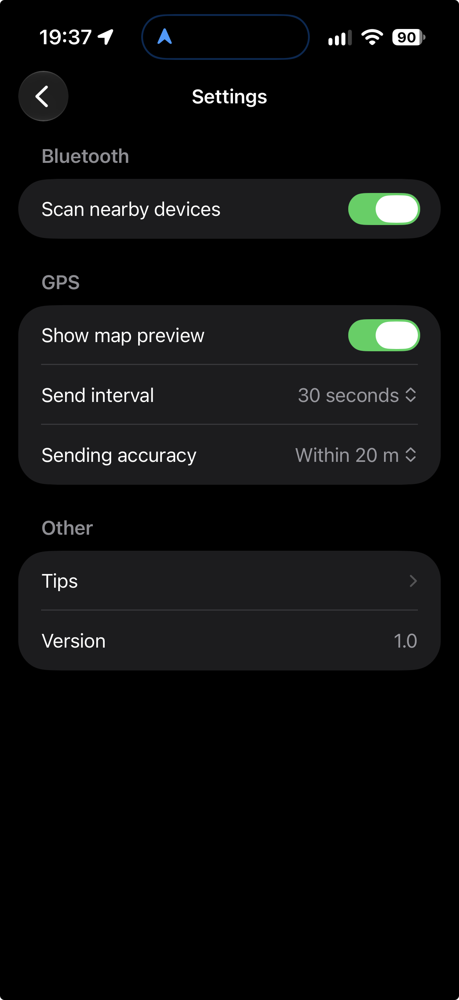

# NSG for iOS

> 中文版：[README.zh-CN.md](README.zh-CN.md)

NSG for iOS is distributed as source code. Use your Personal Team in Xcode to build, sign, and install the app on your own iPhone.

The project uses Automatic Signing and reads the Team ID and Bundle ID from `Config/Local.xcconfig`. Keep your personal values in that file rather than entering them directly in the project's Signing & Capabilities settings.

If you configure signing directly in Xcode's Signing & Capabilities settings, Xcode may save your Team ID and Bundle ID in `project.pbxproj`. This file is not excluded by `.gitignore`, so **do not commit changes containing your personal signing information**.

<p align="center">
  
  
</p>

## Initial setup

Run the following command from the repository's root directory:

```sh
cd ios
cp Config/Local.xcconfig.example Config/Local.xcconfig
```

Set these two values in `Config/Local.xcconfig`:

- `NSG_APP_BUNDLE_ID`: Your unique application identifier in reverse-DNS format.
- `NSG_SIGNING_TEAM`: The Team ID associated with your signed-in Xcode account, not your Apple Account email address or team display name.

<details>
<summary><strong>How to find your Personal Team ID?</strong></summary>

If you do not have a local development certificate yet, create one in Xcode:

1. Open Xcode > Settings > Apple Accounts and sign in to your Apple Account.
2. Select your account, then open your Personal Team.
3. Click Manage Certificates.
4. Click the Add (+) button and choose Apple Development.

Then run the following command in Terminal:

```sh
/usr/bin/security find-certificate -a -c "Apple Development" -p |
awk '
/-----BEGIN CERTIFICATE-----/ { certificate = "" }
{ certificate = certificate $0 "\n" }
/-----END CERTIFICATE-----/ {
    command = "/usr/bin/openssl x509 -noout -subject -dates -nameopt sep_multiline"
    print certificate | command
    close(command)
}'
```

Look for the `OU` (Organizational Unit) field in the output and set `NSG_SIGNING_TEAM` in `Config/Local.xcconfig` to the actual value shown for your certificate. For example:

```text
OU=ABCDE12345
```

</details>

## Build and install

1. Complete the initial setup above and replace both example values in `Config/Local.xcconfig` with your own Bundle ID and Team ID.
2. Open `ios/NSG.xcodeproj` in Xcode and select the `NSG` scheme.
3. Connect your iPhone to your Mac, unlock it, and accept any pairing or Trust This Computer prompts.
4. On your iPhone, open `Settings > Privacy & Security > Developer Mode`. Enable it, restart when prompted, and confirm after restarting. See Apple's [Developer Mode guide](https://developer.apple.com/documentation/xcode/enabling-developer-mode-on-a-device).

    <details>
    <summary><strong>Developer Mode missing on your iPhone?</strong></summary>

    Continue with the remaining steps. When installation prompts you that Developer Mode is disabled, return to `Settings > Privacy & Security` on your iPhone and scroll down. The `Developer Mode` option should now appear.

    </details>

5. Select your iPhone as the run destination in Xcode's toolbar.
6. Choose Product > Run (`Command-R`). Xcode will build, sign, install, and launch NSG on your iPhone. Initial signing requires an internet connection; complete any account authentication or Keychain access prompts.

> **Note:** Personal Team provisioning profiles expire after 7 days. Rebuild and reinstall the app from Xcode when the profile expires. You do not need to recreate the development certificate or look up your Team ID again just because a provisioning profile expired. See Apple's [Personal Team limits](https://developer.apple.com/help/account/basics/about-your-developer-account#enable-a-personal-team-in-xcode).

## Connecting to a camera

- **Connect with NSG and send location updates**

    On the camera, open `MENU > Setup menu > Connect to smart device > Pairing > Start pairing` to enter pairing mode. On your iPhone, allow Bluetooth access for NSG, scan for nearby devices, and tap your camera to connect. Once connected, NSG will automatically attempt to reconnect unless you manually disconnect it in the app. After the first connection, you can reconnect by selecting the camera under `My camera`, without entering pairing mode on the camera again.

    Once location is enabled, NSG sends your phone's current location to the camera every 10 seconds by default. **Location sending options can be adjusted in `Settings`.**

- **Switch between NSG and SnapBridge**

    On the Nikon camera, open `MENU > Setup menu > Connect to smart device > Pairing > Paired devices` and select the device you want to connect to. If you were previously connected with NSG, the selected entry should be `NSG-iOS`. The SnapBridge entry should be named `iPhone_xxxx`; select it, then use SnapBridge on your phone as usual. To switch back to NSG, select the NSG entry again. **You do not need to delete either device's pairing record.**

- **Delete NSG pairing records**

    To completely remove the pairing between NSG and a camera, swipe left on the camera under `My camera` in NSG and tap Delete. Then open `Settings > Bluetooth` on your iPhone and forget the camera. On the camera, open `MENU > Setup menu > Connect to smart device > Pairing > Paired devices` and delete the `NSG-iOS` entry.

## Permissions and background configuration

The app implements Bluetooth camera connections, GPS sync, and background location updates. The app target's build settings and `NSG/Info.plist` supply the following declarations in the built app's `Info.plist`:

- `NSBluetoothAlwaysUsageDescription`: Discover, pair with, and connect to Nikon cameras, and send your phone's GPS location.
- `NSLocationWhenInUseUsageDescription`: Access your location while using the app and send it to the camera.
- `NSLocationAlwaysAndWhenInUseUsageDescription`: Declares the purpose for Always location access; the current implementation requests When In Use authorization only.
- `NSLocationTemporaryUsageDescriptionDictionary`: Contains the `CameraGeotagging` purpose key used to request temporary precise location access for accurate camera GPS coordinates.
- `UIBackgroundModes`: `bluetooth-central` and `location`, enabled for background Bluetooth communication and location updates.

Bluetooth and GPS are enabled by default. Their services start when the app's interface appears, which may trigger permission prompts on first use. Allow Bluetooth access and location access while using the app. If access was denied, review NSG's permissions in iPhone Settings.

## Compatibility and tested devices

Tested on the following devices (You are welcomed to raise a PR to add your devices in the chart):

| iPhone | iOS version | Camera | Camera firmware |
| --- | --- | --- | --- |
| iPhone 18 Pro | 27.0 / 27.2 | Nikon Z5 | 1.43 |

## Issues

If you encounter problems building, signing, or using NSG for iOS, please open an issue. Read [CONTRIBUTING.md](../CONTRIBUTING.md) first.

## References

- [Apple: Adding a build configuration file to your project](https://developer.apple.com/documentation/xcode/adding-a-build-configuration-file-to-your-project)
- [Apple: Developer memberships and free development limits](https://developer.apple.com/support/compare-memberships/)
