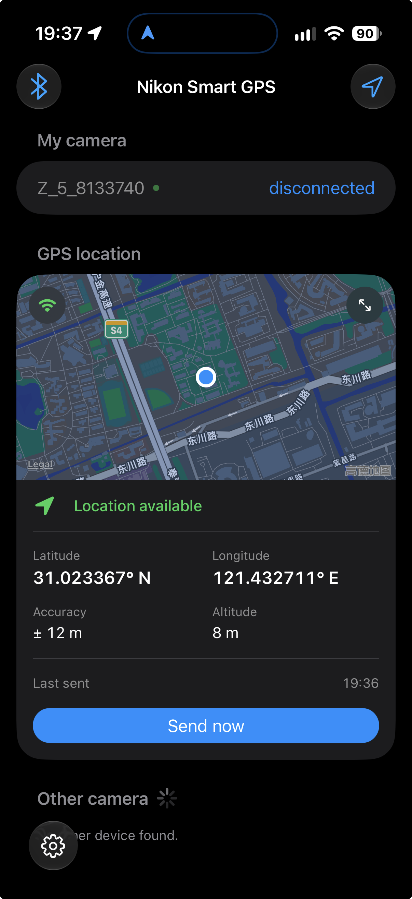
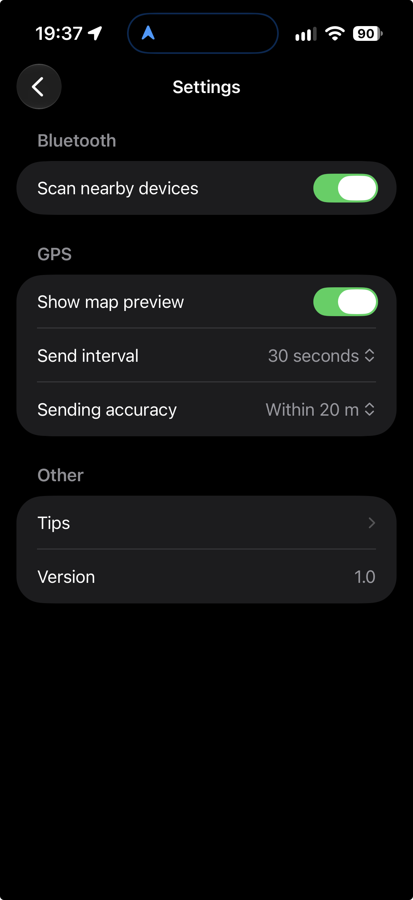

# NSG for iOS

> English README: [README.md](README.md)

NSG for iOS 以源代码形式提供。通过在 Xcode 中使用个人团队（Personal Team）构建、签名，将 App 安装到自己的 iPhone 上。

项目使用自动签名（Automatic Signing），从 `Config/Local.xcconfig` 读取 Team ID 和 Bundle ID。请将个人配置保存在该文件中，不要直接在项目的 Signing & Capabilities 设置中填写。

如果直接在 Xcode 的 Signing & Capabilities 中配置签名，Xcode 可能会将你的 Team ID 和 Bundle ID 保存到 `project.pbxproj`。该文件未被 `.gitignore` 忽略，因此为保护个人隐私，**请勿将包含这些个人信息的改动提交到远程仓库**。

<p align="center">
  
  
</p>

## 初始配置

在仓库根目录运行以下命令：

```sh
cd ios
cp Config/Local.xcconfig.example Config/Local.xcconfig
```

在 `Config/Local.xcconfig` 中设置以下两个值：

- `NSG_APP_BUNDLE_ID`：你的唯一 App 标识符，采用反向域名格式。
- `NSG_SIGNING_TEAM`：你在 Xcode 中登录的账号所关联的 Team ID，而不是 Apple 账户的电子邮件地址或团队显示名称。

<details>
<summary><strong>如何查找个人团队的 Team ID？</strong></summary>

如果本机还没有开发证书，请先在 Xcode 中创建：

1. 打开 Xcode > Settings > Apple Accounts，登录你的 Apple 账户。
2. 选择你的账号，然后打开个人团队（Personal Team）。
3. 点击 Manage Certificates。
4. 点击添加（+）按钮，选择 Apple Development。

然后在终端运行以下命令：

```sh
/usr/bin/security find-certificate -a -c "Apple Development" -p |
awk '
/-----BEGIN CERTIFICATE-----/ { certificate = "" }
{ certificate = certificate $0 "\n" }
/-----END CERTIFICATE-----/ {
    command = "/usr/bin/openssl x509 -noout -subject -dates -nameopt sep_multiline"
    print certificate | command
    close(command)
}'
```

在输出中找到 `OU`（Organizational Unit，组织单位）字段，将证书中显示的实际值填入 `Config/Local.xcconfig` 的 `NSG_SIGNING_TEAM`。例如：

```text
OU=ABCDE12345
```

</details>

## 构建与安装

1. 完成上述初始配置，将 `Config/Local.xcconfig` 中的两个示例值替换为你自己的 Bundle ID 和 Team ID。
2. 在 Xcode 中打开 `ios/NSG.xcodeproj`，选择 `NSG` scheme。
3. 将 iPhone 连接到 Mac，解锁手机，并接受配对或“信任此电脑”的提示。
4. 在 iPhone 上打开 `设置 > 隐私与安全性 > 开发者模式`。启用后按提示重新启动，并在重启后确认。参阅 Apple 的[开发者模式指南](https://developer.apple.com/documentation/xcode/enabling-developer-mode-on-a-device)。
    
    <details>
    <summary><strong>iPhone 上没有开发者模式这一选项？</strong></summary>
    
    直接进行后续步骤，安装时将会提示未开启开发者模式，此时再前往 `设置 > 隐私与安全性`，下拉应该可以发现出现了 `开发者模式` 这一选项。
    </details>
    
5. 在 Xcode 工具栏中，将你的 iPhone 选为运行目标。
6. 选择 Product > Run（`Command-R`）。Xcode 会构建、签名，并将 NSG 安装到 iPhone 上后启动。首次签名需要连接互联网；如出现账号认证或钥匙串访问提示，请按提示完成。

> **注意：**个人团队的预置描述文件（provisioning profile）会在 7 天后过期。过期后，需要通过 Xcode 重新构建并安装 App。仅因预置描述文件过期，无需重新创建开发证书或再次查找 Team ID。参阅 Apple 的[个人团队限制说明](https://developer.apple.com/help/account/basics/about-your-developer-account#enable-a-personal-team-in-xcode)。

## 连接相机

- **使用 NSG 连接相机并发送位置**

    在相机上，通过 `MENU > 设定菜单 > 连接至智能设备 > 配对 > 开始配对` 进入相机配对模式；在手机上，开启 NSG 的蓝牙权限并扫描周围设备，点击扫描到的相机即可完成连接。连接后，除非手动在手机端 NSG 断开连接，否则 NSG 会自动尝试重连。首次连接后吗，后续直接在 `我的设备` 中点选即可再次连接，无需进入相机配对模式。

    打开位置功能后，NSG 默认会每隔 10s 发送手机当前的实时位置至相机。**位置发送相关配置可以在 `设置` 中调整**。

- **NSG 与 SnapBridge 切换**

    在尼康相机上，通过 `MENU > 设定菜单 > 连接至智能设备 > 配对 > 已配对设备` 选择配对的目标设备，若先前与 NSG 连接，这里选中的目标应该是 `NSG-iOS`。SnapBridge 的设备标识应为 `iPhone_xxxx`，选择该设备为目标后，手机端通过 SnapBridge 正常操作即可。后续切换回 NSG 时，则将选中的设备改为 NSG，**无需删除配对的设备记录**。

- **删除 NSG 配对记录**

    若要完全删除 NSG 与某个相机的配对记录，手机端上，在 NSG 的 `我的设备` 中左滑需要删除的条目，并点击删除，并打开 `设置 > 蓝牙`，删除相机与蓝牙的配对记录；相机端，通过 `MENU > 设定菜单 > 连接至智能设备 > 配对 > 已配对设备`，删除 `NSG-iOS` 这条设备记录。

## 权限与后台配置

App 已实现蓝牙相机连接、GPS 同步和后台定位更新。App target 的构建设置与 `NSG/Info.plist` 共同提供以下声明，并将其包含在构建产物的 `Info.plist` 中：

- `NSBluetoothAlwaysUsageDescription`：发现、配对和连接尼康相机，并发送手机的 GPS 位置。
- `NSLocationWhenInUseUsageDescription`：在使用 App 期间获取位置，并将其发送给相机。
- `NSLocationAlwaysAndWhenInUseUsageDescription`：声明“始终”访问位置的用途；当前实现仅请求“使用 App 期间”的定位授权。
- `NSLocationTemporaryUsageDescriptionDictionary`：包含用途键 `CameraGeotagging`，用于请求临时精确定位权限，以便向相机提供准确的 GPS 坐标。
- `UIBackgroundModes`：已启用 `bluetooth-central` 和 `location`，用于后台蓝牙通信和定位更新。

蓝牙和 GPS 默认开启。界面显示后会启动相应服务，首次使用时可能触发权限提示。请允许蓝牙访问和“使用 App 期间”的位置访问。如果之前拒绝了授权，请在 iPhone 的“设置”中检查 NSG 的权限。

## 兼容性与真机测试

NSG 要求 **iOS 26.0 或更高版本**。下表列出了已经过真机测试的配置。

| iOS 版本 | 相机型号 | 相机固件版本 |
| --- | --- | --- |
| 27.0~27.2 | Nikon Z5 | 1.43 |

> 如果你测试了其他配置，欢迎提交 PR，将测试记录添加到表格中。

## 问题反馈

如果在构建、签名或使用 NSG for iOS 时遇到问题，请提交 issue。提交前请先阅读[贡献指南](../CONTRIBUTING.zh-CN.md)。

## 参考资料

- [Apple：为项目添加构建配置文件](https://developer.apple.com/documentation/xcode/adding-a-build-configuration-file-to-your-project)
- [Apple：开发者会员资格与免费开发限制](https://developer.apple.com/support/compare-memberships/)
